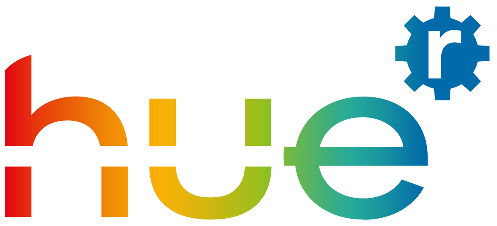
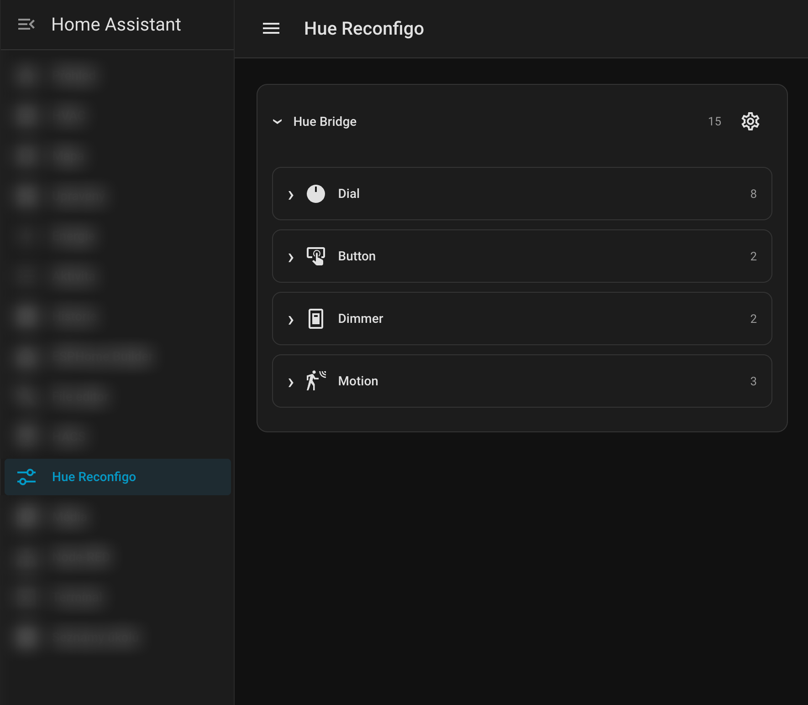

  

# Hue Reconfigo

[Čeština](README.cs.md) | [Slovenština](README.sk.md) | [English](README.md)

Nastavte **Hue Tap Dial, Smart Button, Dimmer v2 a pohybové senzory** přímo v Home Assistantu. Akce, jas, barvu i chování při pohybu zvolíte ve formulářích, bez YAML a samostatných automatizací pro každý ovladač. Ovládejte světla i další kompatibilní zařízení s důrazem na rychlou odezvu a plynulou regulaci.

  

Vyžaduje **Home Assistant 2026.10.1 nebo novější**, **Hue Bridge s API v2** a nastavenou oficiální integraci **Philips Hue**.

**Adaptive Lighting je volitelné.** Pokud ho používáte, zapněte spolupráci v nastavení Bridge, aby mu Hue Reconfigo oznamoval ruční změny jasu a barvy. [Podrobnosti propojení](docs/cs/bridge.md#spolupráce-s-adaptive-lighting).

## Rychlá instalace

1. Do HACS přidejte `https://github.com/tommyzacek/hue-reconfigo` jako vlastní repozitář typu **Integration**.
2. Stáhněte vydání a restartujte Home Assistant.
3. V **Nastavení → Zařízení a služby** přidejte **Hue Reconfigo** a vyberte existující Hue Bridge.
4. V Hue nastavte příslušenství na **Konfigurovat v jiné aplikaci**. Vypněte konkurenční automatizace pro stejné vstupy; oficiální Hue integraci ponechte zapnutou.
5. Jako správce otevřete boční panel **Hue Reconfigo**. Vyberte ovladač, nastavte cíle/akce a zapněte ovládání. Kolo vedle Bridge otevře společná nastavení. Po aktualizacích obnovte stránku.

Po stažení a restartu Home Assistantu:

Ruční instalace: zkopírujte `custom_components/hue_reconfigo` do složky `custom_components` v konfiguraci HA a restartujte. Postranní panel je součástí integrace.

## Uživatelské návody

| Skupina | Návod |
| --- | --- |
| Bridge | [Instalace, společné podmínky, Adaptive Lighting a polling](docs/cs/bridge.md) |
| Dial | [Předvolby kolečka, čtyři tlačítka a dočasné převzetí](docs/cs/dial.md) |
| Button | [Krátký/dlouhý stisk, dvojklik a trojklik](docs/cs/button.md) |
| Dimmer | [ON/OFF, +, − a HUE na Dimmeru v2](docs/cs/dimmer.md) |
| Motion | [Časové bloky, citlivost na světlo, časovač a ruční zásah](docs/cs/motion.md) |
| Společné akce | [Zapnutí, jas, barva, držení, ventilátory a skripty](docs/cs/akce-tlacitek.md) |

Rozhraní i návody jsou česky, slovensky a anglicky. Nové ovladače začínají vypnuté. Nativní přechody Hue mohou hlásit cílový stav před dokončením ztlumení; odezva a plynulost závisejí na zařízeních a síti.

Nezávislý projekt bez vazby na Signify či Home Assistant. Návody sledují aktuální vývoj; rozsah nainstalované verze najdete v [poznámkách k vydání](https://github.com/tommyzacek/hue-reconfigo/releases), omezení v [technických poznámkách](docs/development.md).
