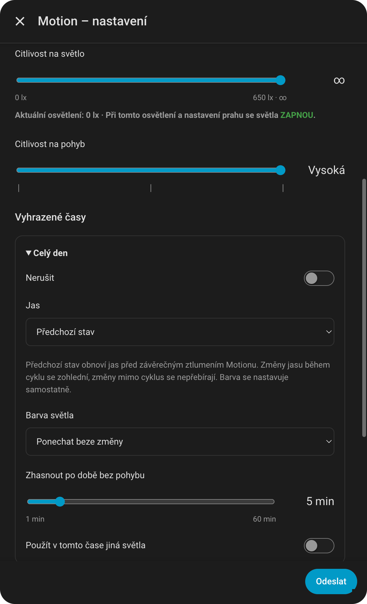

# Motion

[Čeština](../cs/motion.md) | [Slovenština](../sk/motion.md) | [English](../en/motion.md)

[Všechny návody](README.md) · [Bridge a Adaptive Lighting](bridge.md)

Motion rozsvěcí vybraná světla při pohybu a po době bez pohybu je podle nastavení zhasne. Pohyb a osvětlení přebírá z oficiální Hue integrace; nepřidává rychlý polling pohybového senzoru.

  

## První nastavení

1. Otevřete **Hue Reconfigo → Bridge → Motion → váš senzor**.
2. Vyberte cílová světla nebo skupinu.
3. Nastavte citlivost na světlo a pohyb.
4. V bloku **Celý den** nastavte jas, barvu a dobu bez pohybu.
5. Zvolte styl pozvolného zhasnutí a chování při jiném ovládání.
6. Vypněte konkurenční světelné pravidlo tohoto senzoru v Hue, zapněte ovládání v našem formuláři a uložte.

Oficiální senzory a integraci Hue ponechte dostupné. Formulář upozorňuje, pokud je příslušný oficiální pohybový nebo světelný senzor vypnutý. Samotné vypnutí našeho ovládání nevypíná oficiální senzor.

## Citlivost na světlo a pohyb

| Pole | Význam |
| --- | --- |
| **Citlivost na světlo** | Nové rozsvícení je povolené pod zvolenou hodnotou osvětlení. Rozsah je do 650 lx; následující krajní poloha **∞** ruší omezení osvětlením. |
| **Aktuální osvětlení** | Průběžně ukazuje dostupné měření a vyhodnocení prahu ZAPNOU/NEZAPNOU. Jde o výsledek světelné podmínky; ovládání může dále blokovat Nerušit, společná podmínka nebo vypnutá funkce. |
| **Citlivost na pohyb** | Tři polohy Nízká / Střední / Vysoká určují citlivost fyzického senzoru. |

Při konečném prahu musí být měření platné a nižší než práh. Rovnost rozsvícení nepovolí. Vypnutý nebo nedostupný světelný senzor nepovolí nové rozsvícení s konečným prahem. Již svítící světla mohou přesto vstoupit do cyklu a později zhasnout podle nastaveného chování.

Práh osvětlení vyhodnocujeme lokálně a nepřepisujeme jím pravidlo osvětlení v Bridge. Citlivost na pohyb se naopak zapisuje do Bridge při uložení formuláře se zapnutým ovládáním; může tak ovlivnit detekci využívanou i jinde.

## Vyhrazené časy

Jediný blok se jmenuje **Celý den** a nemá editovatelný začátek. Přidáním dalšího bloku den rozdělíte: zadává se začátek každého bloku a konec určuje začátek následujícího. Poslední navazuje přes půlnoc na první. Časy se řídí místním časem HA a nesmějí se opakovat.

| Příklad bloku | Jas a barva | Zhasnout po době bez pohybu |
| --- | --- | --- |
| 07:00–23:00 | 80 %, bílá 4000 K | 5 minut |
| 23:00–07:00 | 15 %, bílá 2300 K | 1 minuta |

Každý blok má vlastní jas, barvu, časovač, případný výběr jiných světel a **Nerušit**. Citlivosti, styl zhasnutí a chování při ovládání jsou společné pro celý Motion.

**Nerušit** nezahajuje nové cykly. Cyklus začatý v předchozím bloku se ale dokončí podle původně vybraného nastavení, včetně prodlužování pohybem a návratu jasu ze závěrečného ztlumení. Přechod do jiného bloku sám nepřenastaví svítící světla.

### Jas a barva při zahájení

- **Jas → Nastavené %** pošle zvolenou úroveň.
- **Jas → Předchozí stav** obnovuje uložený jas před vlastním závěrečným ztlumením. Tím brání opakovanému půlení 100 → 50 → 25 % mezi cykly. Bez uložené hodnoty se jas neposílá.
- **Barva → Ponechat beze změny** neposílá barvu. Další možnosti jsou teplota bílé a vlastní barva pro podporovaná světla.

Paměť jasu neobnovuje barvu a není historií všech externích změn. Změna jasu během cyklu se zohlední při pořízení snímku před závěrečným ztlumením. Novější rozsvícení jiným způsobem ze stavu vypnuto zneplatní dřívější uložený jas, aby jej následné zapnutí nepřepsalo starou hodnotou. Samostatná změna barvy se řídí její vlastní volbou.

## Cyklus a časovač

První přijatý pohyb zahájí cyklus. Motion provede nastavené zapnutí podle pravidel pro již svítící světla. **Doba bez pohybu začne běžet až poté, co senzor oznámí klid.** Pokud dál nepřetržitě hlásí pohyb, světla kvůli tomuto časovači nezhasnou.

Nový pohyb během cyklu časovač přeruší. Po dalším klidu začne celá nastavená doba znovu. Běžné obnovení nepoužívá opakovaně počáteční jas a barvu. Pokud již začalo závěrečné ztlumení, obnoví se jeho uložený výchozí jas.

Posuvník nabízí **1–10 minut po půlminutách**, nad 10 minut po celých minutách do **60 minut**. Změna a uložení konfigurace ruší starý běžící cyklus; starý odpočet se nemá přenášet do nového nastavení.

### Pozvolné zhasnutí

Začíná posledních **30 sekund** odpočtu. Každé světlo používá svůj aktuální jas při zahájení ztlumení.

| Styl | Posledních 30 sekund |
| --- | --- |
| Plynulé ztlumení na 50 % | Během 30 s přejde na polovinu výchozího jasu, potom se vypne. |
| Plynulé dohasnutí | Během 30 s postupně zhasíná k nule. |
| Rychlé ztlumení na 50 % a vypnutí | Během 2 s přejde na polovinu, čeká a vypne se na konci odpočtu. |

Příklad: Motion rozsvítí na 100 %, vy během cyklu stáhnete na 60 %. Polovina při závěru znamená **30 %**, nikoli 50 %. Návrat při pohybu obnoví **60 %**.

Počáteční rozsvícení a návrat ze ztlumení mají přechod **0,5 s**, konečné vypnutí **2 s**. Bez zapnutého pozvolného zhasnutí zůstane světlo až do konce odpočtu a poté dostane vypnutí s tímto přechodem.

Hue může do HA okamžitě nahlásit cílový jas či vypnutí, i když fyzicky ještě probíhá rampa. Údaj ani historie HA pak nejsou měřením skutečné okamžité svítivosti. Integrace tento údaj uměle nepřepisuje odhadem.

## Světla, která už svítí při příchodu

Tato dvě pole platí pouze pro světla rozsvícená před zahájením cyklu. V jedné skupině se tak mohou jednotlivé členy chovat různě.

| Pole | Volba | Výsledek |
| --- | --- | --- |
| Při prvním pohybu | Použít nastavený jas a barvu ze sekce „Vyhrazené časy“ | Při zahájení se použije nastavení aktuálního časového bloku, pokud to dovolí světelná podmínka. |
| Při prvním pohybu | Ponechat aktuální jas a barvu | Světlo nechá v aktuálním vzhledu a zahrne do cyklu. |
| Po uplynutí času bez pohybu | Zhasnout také tato světla | Automatické zhasnutí se vztahuje i na původně svítící světla. |
| Po uplynutí času bez pohybu | Nechat je svítit | Původně svítící světla závěrečnou rampou ani vypnutím neovlivní. |
| Po uplynutí času bez pohybu | Vrátit jas a barvu z okamžiku příchodu | Na konci jim vrátí zachycený původní vzhled. |

Příklad: před příchodem svítí lampa na 40 %, strop je vypnutý. S volbami Ponechat aktuální jas a barvu + Nechat je svítit zůstane lampa na 40 %, Motion rozsvítí strop a na konci zhasne jen strop.

## Zásah ovladačem

**Platí pouze pro ovladače nastavené v Hue Reconfigo. Změny z aplikací ani jiných automatizací se za zásah ovladačem nepovažují.** Externí změna může ovlivnit aktuální jas použitý pro závěrečnou rampu, sama však neaktivuje níže uvedené předání řízení.

### Po ruční změně jasu nebo barvy má Motion automaticky zhasnout?

| Volba | Příklad: Motion ovládá lampu a strop, ovladačem změníte lampu |
| --- | --- |
| **Ano, všechna světla** | Změna lampy zůstane. Časovač pokračuje; na konci zhasne lampa i strop podle ostatních pravidel. Další běžný pohyb nevynutí znovu počáteční jas/barvu. |
| **Ne, žádná světla** | Automatické řízení se předá uživateli pro celý aktuální výběr Motionu. Strop kvůli tomu nezmění jas, ale ani automaticky nezhasne. |
| **Jen světla, která nebyla ručně ovládaná** | Lampa se předá uživateli, strop dál zhasne podle cyklu. |

Tyto volby neurčují novou barvu ani jas při samotném zásahu. Určují, která světla dál řídí Motion. Stále platí samostatné pravidlo pro světla, která svítila už před příchodem.

U předaných světel se plné řízení obnoví až po **jejich vypnutí, dokončení původního cyklu a nové detekci pohybu**. Není tu časovač návratu. Samotný uplynulý čas ani návrat senzorového klidu je znovu nepřevezme. Dokud senzor hlásí pohyb, původní cyklus ještě nemusel dokončit odpočet.

### Když ovladačem zhasnu

| Volba | Výsledek pro právě vypnutá světla |
| --- | --- |
| **Další pohyb smí znovu hned rozsvítit** | Následující nová detekce může světla vrátit do běžícího cyklu. |
| **Ponechat zhasnuté do skončení aktuálního cyklu** | Nový pohyb je během tohoto cyklu nerozsvítí. Další nový cyklus je může převzít. |

„Hned“ znamená při následující nové události pohybu. Pokud senzor stále hlásí souvislý pohyb, integrace nevytváří umělou novou detekci. Pravidlo platí pro skutečně vypnutá světla, automaticky nerozšiřuje zásah na všechna světla místnosti.

## Tři praktické sestavy

| Cíl | Již svítící při příchodu | Po odpočtu | Po ruční změně |
| --- | --- | --- | --- |
| Chodba: Motion vše obslouží | Použít nastavení časového bloku | Zhasnout také tato světla | Ano, všechna světla |
| Obývák: respektovat rozsvícenou lampu | Ponechat aktuální jas/barvu | Nechat je svítit | Jen světla, která nebyla ručně ovládaná |
| Místnost: ruční změnou převzít celé osvětlení | Podle potřeby | Podle potřeby | Ne, žádná světla |

Pro blokování při nepřítomnosti použijte [společnou podmínku entity](bridge.md#blokovat-chování-entitou) a zahrňte Motion. Jde o samostatnou podmínku, která platí ve všech časových blocích.
