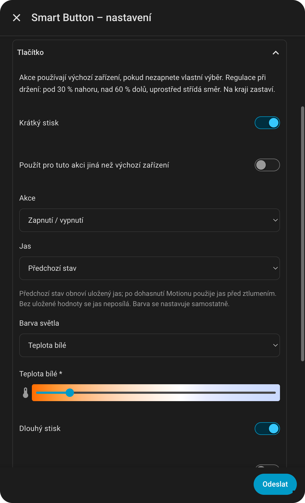

# Button

[Čeština](../cs/button.md) | [Slovenština](../sk/button.md) | [English](../en/button.md)

[All guides](README.md) · [Shared button actions](akce-tlacitek.md)

Button has one physical button. The integration distinguishes short, long, double and triple presses. Supported model identifiers are ROM001, RDM003 and RDM005; RDM005 support is based on model mapping rather than physical validation of every feature.

  

## Basic setup

1. Open **Hue Reconfigo → Bridge → Button → your controller**.
2. Select **Default lights / devices**.
3. Enable the gestures you want and select each action.
4. For long press, you can choose **Continuous regulation while held**.
5. Enable control and submit the form.

Before testing, disable the Button's original Hue app actions. Concurrent assignments can activate scenes or change colors while the integration also sends commands.

## Example: normal and evening light

| Gesture | Action | Brightness | Color |
| --- | --- | --- | --- |
| Short | Turn on / off | Configured 70% | White 4000 K |
| Double | Turn on only | Configured 25% | White 2300 K |
| Long | Continuous regulation while held | According to holding | Unchanged by this action |
| Triple | Disabled | — | — |

Double press changes the appearance even when the light is already on. Short press turns it off. Enabling double press means short-press recognition waits for possible continuation.

For another target on just one gesture, enable **Use different devices for this action**. A triple press could then run a script while other gestures control lights.

Saved brightness, groups, regulation and scripts are explained in [shared actions](akce-tlacitek.md). If Motion also controls these lights, configure its reaction in [Motion controller intervention](motion.md#controller-intervention).
